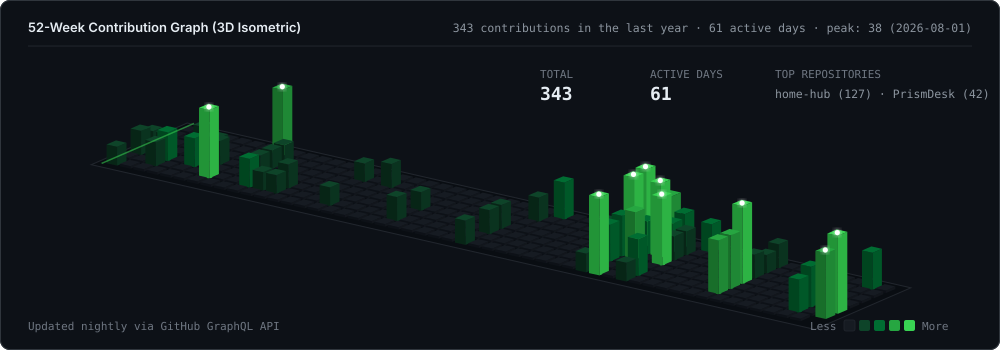

  

 

  

 

### Selected Work

- **[`etab-note`](https://github.com/yigitcnsn/etab-note)** (`C`, `Linux 3.4`, `ARMv7`) — Standalone bare-Linux OS for an MT8392 tablet with 0% Android (~60 MB RAM), 60 FPS `/dev/graphics/fb0` Wacom EMR engine, RFC 2131 DHCPv4 client, mDNS (`etab.local`), HTTP drop server, and iCloud Markdown sync.
- **[`home-hub`](https://github.com/yigitcnsn/home-hub)** (`Node.js`, `WebSocket`) — Modular Raspberry Pi dashboard with real-time WebSocket state sync, background job queues, and hardware telemetry complications.
- **[`PrismDesk`](https://github.com/yigitcnsn/PrismDesk)** (`Python`, `OpenCV`) — Spatial AR workbench using camera-to-projector homography calibration (`H` matrix) to project measured overlays onto a physical desk.
- **[`vaultwire`](https://github.com/yigitcnsn/vaultwire)** (`TypeScript`, `MCP`) — Model Context Protocol server connecting Claude Desktop and Claude Code to a local Obsidian vault over HTTPS.
- **[`pi-llm`](https://github.com/yigitcnsn/pi-llm)** (`Shell`, `Ollama`) — Local LLM pipeline classifying live KAP financial disclosures in tandem with `home-hub`.

More projects (macOS, mobile, RF &amp; custom hardware)

 

- **Engram &amp; macOS Tools** (`Swift 5.10`, `SwiftUI`, `WidgetKit`, `IOKit`) — *Engram* (iCloud Markdown &amp; PencilKit note app), *AIUsageTracker* (MenuBarExtra &amp; WidgetKit quota monitor), and *KeyboardManager* (custom `0xFF1C` USB HID RGB lighting driver).
- **LarGer** (`Flutter`, `Dart`) — Local-first mobile workout, routine, and PR progression tracker.
- **Vanguard32 &amp; Power Electronics** (`C++`, `ESP32-S3`, `STM32`, `nRF52`, `KiCad 10`) — 433 MHz Sub-GHz spectrum analyzer (`Vanguard32`), 6-channel 15A 19.53 kHz MOSFET PWM LED controller PCB, and industrial Python/Modbus automated test equipment (`ORTEQ`).

---

### 🧰 Toolbox

  

  <a href="mailto:yigitcansen1@gmail.com">yigitcansen1@gmail.com</a> · Istanbul

