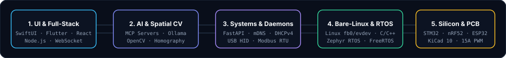
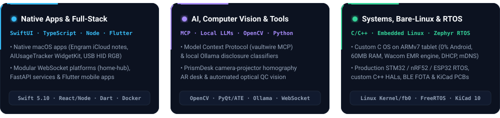

  

 

   AI <-> Systems <-> RTOS <-> Silicon" width="100%" />

 

  

---

### 🚀 Featured Software & Systems Projects

| Project | Stack & Layer | What It Is |
| :--- | :--- | :--- |
| **[`etab-note`](https://github.com/yigitcnsn/etab-note)** | `C` · `Linux Kernel` · `ARMv7` · `Systems` | **Standalone Bare-Linux Tablet OS** — Stripped 100% of Android off an MT8392 tablet; boots straight into a ~240 KB static C binary rendering to `/dev/graphics/fb0` at 60 FPS (~60 MB total RAM), custom RFC 2131 DHCPv4 daemon, mDNS (`etab.local`), HTTP AirDrop server, Obsidian Markdown visualizer, and two-way iCloud sync. |
| **[`vaultwire`](https://github.com/yigitcnsn/vaultwire)** | `TypeScript` · `MCP` · `Node.js` · `AI Tooling` | **Model Context Protocol (MCP) Server for Obsidian** — Enables LLM agents (Claude Desktop / Claude Code) to query, search, and mutate a local Obsidian knowledge vault over HTTPS. |
| **[`home-hub`](https://github.com/yigitcnsn/home-hub)** | `JavaScript` · `Node.js` · `WebSocket` · `Full-Stack` | **Modular Smart-Home & Telemetry Platform** — Real-time WebSocket web app with Apple Watch–style system complications, background job queues, and local network device orchestration. |
| **[`PrismDesk`](https://github.com/yigitcnsn/PrismDesk)** | `Python` · `OpenCV` · `Homography` · `Spatial CV` | **Spatial AR Workbench** — Camera↔projector homography calibration (`H` matrix) and computer-vision pipeline turning a physical desk into an interactive measured AR surface and live HUD. |
| **[`pi-llm`](https://github.com/yigitcnsn/pi-llm)** | `Shell` · `Ollama` · `REST API` · `Local AI` | **Autonomous Financial Disclosure Classifier** — Local LLM inference pipeline classifying live KAP (Public Disclosure Platform) filings as good/bad/neutral in tandem with `home-hub`. |
| **Engram & macOS Suite** | `Swift 5.10` · `SwiftUI` · `WidgetKit` · `IOKit` | **Native macOS Applications** — *Engram* (iCloud Markdown & PencilKit note app), *AIUsageTracker* (MenuBarExtra & WidgetKit live token/quota monitor), and *KeyboardManager* (custom USB HID `0xFF1C` RGB driver). |
| **LarGer** | `Flutter` · `Dart` · `Local-First` · `Mobile` | **Cross-Platform Workout & PR Tracker** — Local-first mobile app for building routines, logging sets with live rest timers, and visualizing volume/PR progression. |
| **Vanguard32 & Power HW** | `C++` · `Zephyr / ESP32` · `STM32 / nRF52` · `KiCad` | **Embedded Firmware & Custom Hardware** — Sub-GHz 433 MHz spectrum analyzer (`Vanguard32`), 6-ch 15A 19.5 kHz MOSFET PWM controller PCB, and industrial Python/Modbus automated test equipment (`ORTEQ`). |

---

### 🛠️ Tech Stack Across the Layers

  
  
  
  
  
  
  
  
  
  
  
  

  📫 Reach me at <a href="mailto:yigitcansen1@gmail.com">yigitcansen1@gmail.com</a> · Istanbul, Türkiye

